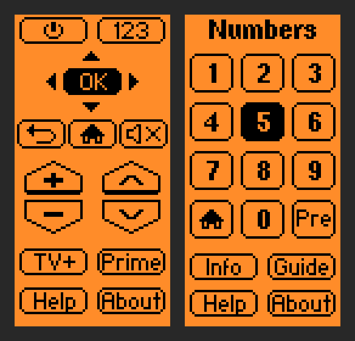
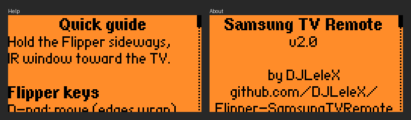

# Samsung TV Remote for Flipper Zero

A full Samsung TV remote for the [Flipper Zero](https://flipperzero.one/). Hold the Flipper sideways with its IR window pointing at the TV: the screen is rotated and the D-pad follows it, like a real remote control.



*These previews are rendered from the app's own layout with the Flipper's built-in fonts. They are not photos of a real device.*

## Features

- **Main page:** power, D-pad with OK, return / home / mute, volume and channel rockers, Samsung TV Plus, Prime Video, Help and About.
- **Number pad page** (select `123` and press OK): digits 0-9, home, previous channel, info and guide.
- **No `.ir` files:** every key is a Samsung32 IR message built in code.
- **Full taps:** each press sends one frame followed by two repeat frames, like a real remote. On the TV this was tested with, a single frame worked for power and volume but was ignored for arrows, digits and menus.
- **Wrap-around:** moving past the edge of a page continues on the other side, and so does scrolling in Help and About.
- **Built-in Help and About screens**, scrolled with Up and Down.
- The LED blinks when a key is sent. The Flipper does not vibrate.



## Controls

| Flipper key | What it does |
|---|---|
| D-pad | Moves the selection. It wraps around at the edges. |
| OK | Sends the selected key. Hold it to repeat the key. |
| Back | Number pad, then main page, then exits the app. Closes Help and About. |

## Keys and IR codes

All keys use the Samsung32 protocol with address `0x07`.

| Key | Command | Key | Command |
|---|---|---|---|
| Power | `0x02` | Return | `0x58` |
| Volume up | `0x07` | Home | `0x79` |
| Volume down | `0x0B` | Mute | `0x0F` |
| Channel up | `0x12` | Samsung TV Plus | `0xB4` |
| Channel down | `0x10` | Prime Video | `0xF4` |
| Up | `0x60` | Previous channel | `0x13` |
| Down | `0x61` | Info | `0x1F` |
| Left | `0x65` | Guide | `0x4F` |
| Right | `0x62` | 0 | `0x11` |
| OK | `0x68` | 1 to 9 | `0x04` `0x05` `0x06` `0x08` `0x09` `0x0A` `0x0C` `0x0D` `0x0E` |

Each code is the most common one for that key across the Samsung TV remotes in [Flipper-IRDB](https://github.com/Lucaslhm/Flipper-IRDB). Samsung models differ, so a key can still do nothing on your TV. If that happens, change its code in `send_ir_code()` in `samsung.c`.

Power uses `0x02`, which older remotes send. Newer Samsung Smart Remotes send `0xE6` instead, so try that one if the TV does not switch on and off.

## Install

1. Build the app (see below). The result is `dist/samsungtvremote.fap`.
2. Copy it to the SD card of your Flipper, for example into `SD/apps/Infrared/`.
3. Open it on the Flipper from **Apps → Infrared**.

## Build

You need [ufbt](https://github.com/flipperdevices/flipperzero-ufbt):

```bash
pip install --upgrade ufbt
```

Download the SDK that matches the firmware on your Flipper, then build:

```bash
ufbt update --channel release
ufbt
```

`ufbt launch` builds the app, copies it to a connected Flipper and starts it.

An app is built for one firmware API version. If the Flipper reports an API mismatch after a firmware update, update the SDK and build again. This project was developed and tested on a Flipper Zero running Unleashed `unlshd-094` (API 88.19). For that firmware, load its SDK instead of the official one:

```bash
ufbt update --url https://github.com/DarkFlippers/unleashed-firmware/releases/download/unlshd-094/flipper-z-f7-sdk-unlshd-094.zip
```

## How the IR codes are sent

```c
InfraredMessage message = {
    .protocol = InfraredProtocolSamsung32,
    .address = 0x07,
    .command = 0x02, // Power
    .repeat = false,
};
infrared_send(&message, 3); // one frame followed by two repeat frames
```

## Credits

This app is based on [flipper-samsung-remote](https://github.com/purplefox-io/flipper-samsung-remote) by Tyler Berndt ([purplefox.io](https://purplefox.io/blog/flipper-samsung-remote)), which provided the rotated layout, the button drawing and the idea of sending the IR codes from code.

Added in this version: the number pad page, Samsung TV Plus (in place of Netflix), Home, Info and Guide keys, icon buttons for power, return, home and mute, slimmer volume and channel rockers, full-tap sending, wrap-around navigation, the Help and About screens, a corrected Prime Video code, and no vibration.

## License

GNU General Public License v3.0, see [LICENSE](LICENSE). The original work by Tyler Berndt is released under the MIT License, see [LICENSE-MIT](LICENSE-MIT).
